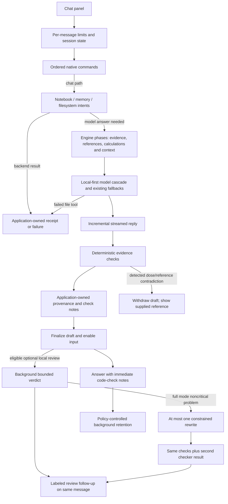

# Cursiv architecture

This is the current source map. Published artifacts and historical measurements
remain documented separately in [U89 verification](docs/U89-RELEASE-VERIFICATION.md).
The engine package is `cursiv_engine`; persistent data paths have not been renamed.

## Start here for new contributors

1. Read this message flow and ownership table.
2. Read [TECH.md](TECH.md) for data locations, source setup and release safeguards.
3. Open [the chat facade](cursiv_engine/ui/chat_app.py), then follow
   `chat/conversation.py` and `chat/completion.py`. The desktop enters through
   `launcher/chat_panel.py`; backend operations produce receipts before UI rendering.

[CONTRIBUTING.md](CONTRIBUTING.md) gives the short setup and validation path.
Short `core/`, `chat/` and `memory/` paths below are relative to `cursiv_engine/`.
The engine has no Qt dependency; launcher owns widget lifecycles and entry points.

## Desktop and chat

| Boundary | Responsibility / entry point |
|---|---|
| `launcher/main.py`, `cursiv_launcher.py` | Startup, login gate, single instance, main window, updater. Release version matches the installer; stable asset names remain fixed. |
| `launcher/shell_dialogs.py` | Fleet/access dialogs and Qt window frame. |
| `launcher/chat_panel.py` | Turn lifecycle, conversation navigation and worker signals. |
| `launcher/chat_feedback.py`, `core/feedback.py` | GUI-thread state/receipt presentation and short factual formatters; model prose cannot create execution receipts. |
| `launcher/chat_review.py`, `chat/review.py` | Snapshot eligible review evidence; finish the draft before a local worker runs; apply labeled follow-ups in Qt with generation/cancellation guards. |
| `launcher/chat_controls.py`, `chat_transcript.py`, `chat_rendering.py` | Controls, transcript operations, incremental Markdown and message cache. Qt widgets stay on the GUI thread. |
| `launcher/chat_commands.py` | Compatibility facade and desktop command entry point; re-exports the engine result classes. |
| `cursiv_engine/core/command_api.py` | Shared result types, command runtime protocol and `UNHANDLED` sentinel. Consolidates the former separate launcher type modules without changing result identity. |
| `launcher/command_dispatch.py`, `commands_*.py` | Ordered command domains. `UNHANDLED` continues dispatch; intentional `None` defers to guarded chat. |
| `launcher/command_agents.py`, `command_media.py`, `command_support.py` | Agent helpers, media/training adapters and supporting commands. |
| `launcher/login_style.py`, `login_recovery.py`, `login_dialog.py` | Shared controls, security questions/recovery, login/account setup. Existing class imports are preserved. |
| `launcher/setup_checks.py`, `setup_dialog.py` | Engine readiness checks and setup view. Platform engine operations remain in `core/ollama_host.py`. |
| `launcher/usb_ops.py`, `usb_maker.py` | USB planning/copy/verification operations and drive-making view. |
| `cursiv_engine/ui/chat_app.py` | Stable chat facade, configuration, imports and legacy per-turn records. No Qt dependency. |
| `cursiv_engine/chat/runtime.py` | Explicit dependency protocol passed to extracted implementations. |
| `chat/context.py`, `uploads.py` | Prompt/evidence assembly, upload text and tool receipts. |
| `chat/provenance.py`, `core/grounding.py` | Application-owned source formatting and scoped supplied-memory/execution records; no answer-word attribution. |
| `core/native_answers.py`, `chat/response_style.py` | Bounded feature/workflow/version/calculation replies before model generation; scoped style guidance and conservative final closer cleanup. Neither prose nor a help answer grants or proves tool execution. |
| `core/conversation_kind.py` | Pure relevance/dialogue classification. Casual retrieval suppression leaves current-thread history, explicit recall and policy enforcement separate. Philosophy is model conversation, not native status boilerplate. |
| `core/action_gate.py`, `feature_answers.py` | Pure pre-dispatch denial under effective turn policy; reviewed workflow facts and honest unavailable replies without model invention. |
| `core/deterministic_overrides.py`, `fieldmath.py`, `review_policy.py` | Application-authored withdrawals from supplied evidence; full-match flow arithmetic; pure optional-review eligibility behind the existing verify compatibility API. |
| `chat/conversation.py`, `routing.py` | Phase orchestration, model selection/fallback, short router calls. |
| `chat/local_provider.py`, `cloud_providers.py`, `provider_tools.py` | Existing provider adapters and authenticated execution results. |
| `chat/streaming.py`, `completion.py` | Stream filtering/sentinels, final checks, optional single rewrite, retention scheduling. |

Compatibility wrappers pass an explicit runtime object. Implementations do not
import the facade or install replacement module globals. Existing call overrides
still reach extracted functions. The runtime protocols list their dependencies;
some types remain broad to accommodate optional integrations.

U85 progress events surround actual reviewer invocations after availability
checks. Clean results persist bounded review metadata without reparsing the
transcript. Notebook saves/imports read back stored data before success; existing
append-only record formats and authorization boundaries remain in place.

## One response

Native state changes return backend receipts. Model text never proves a write.
Failed `file remember` writes do not initiate a secondary memory save. Final
prompt assembly records supplied memory separately from retrieved/withheld facts;
source status and review evidence use that scoped tuple. Source formatting takes
no model-answer input. See [the trust follow-up](docs/TRUST-BOUNDARY-FOLLOWUP.md).
Failed file tools stop model continuation. Scoped execution records drive tool
source labels. Detected dose/reference contradictions use the original supplied
reference and do not schedule another model rewrite or learn from that draft.
An unavailable check cannot produce a clear/verified result. The detailed
decision rules are in [verification policy](docs/VERIFICATION-POLICY.md).
Desktop background jobs copy evidence/scoped context and never update the legacy
session ledger. New turns and conversation changes reject stale results. Pending
assistant claims are not promoted to verified memory by a later review. See
[review modes, timing and cancellation limits](docs/ASYNC-ANSWER-REVIEW.md).

## Logic and storage

- `core/`: calculations, reference lookup, verification, authorization, network
  gate, filesystem and notebook backends. New assessment/problem modules have no
  widget or model dependencies. Some legacy core modules still own I/O.
- `memory/`: semantic facts, explicit intents, dated recall, automatic formation,
  sessions and project context. Existing JSON/JSONL formats are preserved.
- `guardian/`: account/owner checks and protected paths. Filesystem mutations
  enforce guardian protection in `core/file_access.py`, including confirmations.
- `core/fieldlog.py`: original append-only notebook and SHA-256 chain. Team
  sharing and signing still use their existing backends.
- `core/paths.py` and `launcher/portable.py`: installed/portable data locations;
  model weights and workspace grants retain their existing rules.
- `website/` and `cloudflare/`: independent website deployment. This maintenance
  work does not deploy it; package-path references are updated mechanically.

## Storage boundary

`core/private_store.py` is the explicit read/append boundary for protected stores;
`core/atomic.py` protects covered writes before creating a temporary file.
`core/vault.py` owns coverage, passphrase-derived session keys and authenticated,
path-bound envelopes. `core/vault_migration.py` owns the startup-only migration and
encrypted recovery snapshot. The desktop holds `core/data_lease.py`'s OS lease and
unlocks through `launcher/encryption_dialog.py` before importing chat stores.

Encryption is opt-in and off by default. Notebook chains/signatures do not pass
through this layer. [Coverage and recovery](docs/ENCRYPTION-MIGRATION-PLAN.md)
explicitly exclude documents/workspace files, logs and intentional exports/training
copies. No real owner stores were migrated by this development task.

## Surface area and remaining coupling

The research profile hides personal UI and blocks typed letter/vault operations
until “Show personal features” is enabled. No existing letter data or active
backend was deleted. Storage/permission controls still apply when enabled.

Command audit: `commands_*` modules contain distinct ordered domains; `command_agents`,
`command_media` and `command_support` supply adapters used by those domains.
`chat_commands` remains the single compatible facade because tests and adapters
replace its runtime services. Consolidating the two pure type modules into
`core/command_api.py` removes one module without changing dispatch precedence.
The remaining domain handlers are not duplicate pass-through entry points.

Obvious remaining ownership exceptions in launcher:

- `usb_ops.py` contains copy planning, drive verification and filesystem operations;
  it belongs in an engine/platform service eventually. Moving it now would expand
  a storage-security change into the portable release pipeline.
- `conversations.py` contains storage scheduling as well as desktop conversation
  lifecycle. Encryption integration centralizes its file boundary, but moving its
  executor and title callbacks needs separate lifecycle work.
- `command_media.py` contains provider/training operations mixed with command
  adapters. Keep extracting only with tests for that specific domain.

These exceptions are flagged rather than asserting launcher is already UI-only.
No dead personal backend was identified with enough evidence to delete safely;
existing letter/vault integrity tests are active.

The facade still owns mutable per-turn records, and verification retains its
session ledger/previous-failure state. The desktop serializes its active turns;
this extraction does not establish safe concurrent chats in a future server.
Gradually replacing those records with an explicit per-turn state object is
separate work. External plugins execute trusted Python with process privileges.
See the [threat model](docs/THREAT-MODEL.md) and
[maintenance report](docs/MAINTENANCE-HARDENING.md).
