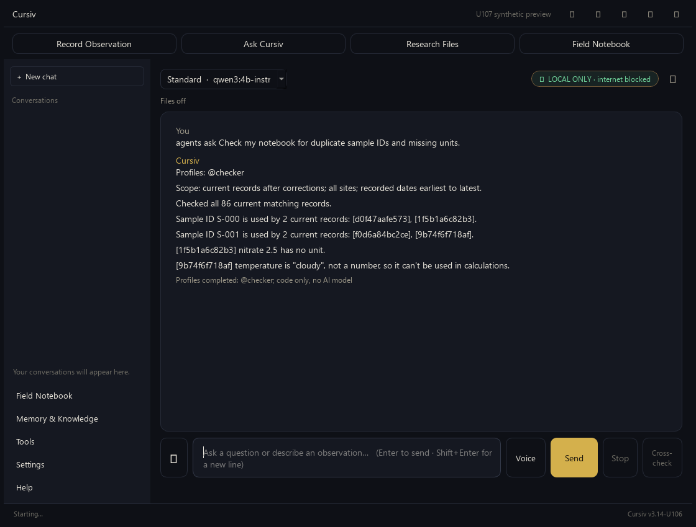
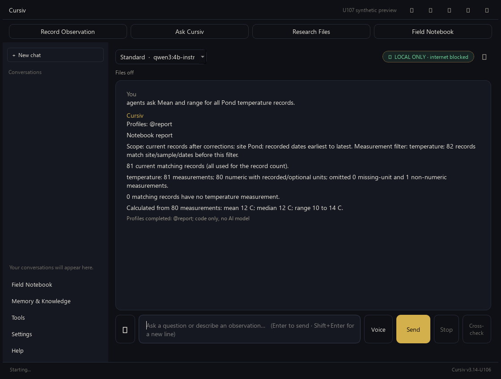

# U107 agent reliability preview

Joshua reviewed this implementation and authorized release on October27. These screenshots and
measurements record that review; current release/publication status is in [the handoff](U107-HANDOFF.md).

`agents ask` now works with the shipped profiles. It picks the relevant role instead of asking the
first three personal agents. You can choose up to three explicitly, for example
`agents ask @field,@writer: <question>`. Personal overrides still win.

Notebook checks and basic statistical reports are calculated in code across the complete matching
records. Units, missing/non-numeric data and coverage are explicit. General field-note tips need no
model or private records. Protocol/writing work uses the local model where it adds value; unsupported
citations, quantities or action claims are withdrawn rather than presented as checked facts.

Queued work now has real states and a bounded local read-only executor. Placeholder text cannot mark
a task complete. Old/interrupted tasks require review or reconciliation before retry. Tests and the
live proof used only synthetic queues; no owner task was replayed.

Cancellation and conversation/workspace/person changes reject stale replies and history updates.
The five read-only profiles, native confirmation boundaries and optional integrations remain distinct.

The final small real-Qwen sample measured 81% fewer group model tokens and 83% lower median completion
time on three comparable routine tasks. Individual median time improved by 14%. All six original and
five reserved questions met the requested substance through individual/group/plural routes in the
final retest. This is targeted local evidence, not a guarantee about every model answer. The reserved
set is now a previously seen regression set. Earlier failed trials and unrequested writing timing
rhetoric remain documented for review.

These screenshots use the actual desktop send/answer path with disposable synthetic data:

Full Windows checks passed: **2382 tests, 15 skips, 19 subtests**; the separate automated USB gate
passed **45/45** at that review checkpoint. Subsequent tagged Windows/Mac native packages passed;
see [release verification](U107-RELEASE-VERIFICATION.md). Physical-drive testing is not claimed.
See [validation](U107-VALIDATION.md) for measurements, limits and
the defect-to-test matrix; [handoff](U107-HANDOFF.md) for current processes and remaining work.
Tagged packages and publication are verified separately from these implementation results.
